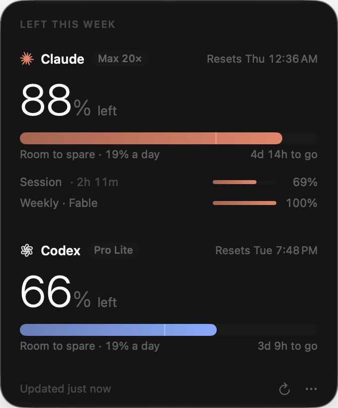

# Headroom

What's left of your **Claude** and **Codex** week, quietly, in the Mac menu bar.



The menu bar shows `✳ 88%  ✿ 66%`: weekly limit left on your Claude plan and your ChatGPT/Codex plan.
Click it for the details:

- **% left this week** and when it resets
- **Pace**: a tick on the bar marks where you'd be if you spent evenly through the week, with "Room to spare",
  "On pace" or "Running hot", and how much a day you can use from here
- **Session and per-model limits**: Claude's 5-hour session and any per-model weekly limits (e.g. Opus, Fable),
  and Codex's 5-hour window on plans that have one

It refreshes every 5 minutes, after wake, and when you open the panel. It starts at login (you can turn that off in the `⋯` menu).

## Install

Needs macOS 26 (Tahoe) or later and Xcode 26+ command line tools.

```sh
git clone https://github.com/yask123/headroom && cd headroom
./build.sh --install     # builds, copies to /Applications, launches
```

## Signing in

- **Codex**: nothing to do if you've signed in to Codex (the CLI or the app) on this Mac. Headroom reads
  `~/.codex/auth.json` (or `$CODEX_HOME`). If the token has expired it refreshes it the way Codex does and writes
  the new tokens back, so Codex stays signed in.
- **Claude**: press **Connect Claude** once. It's the same browser sign-in `claude /login` uses (OAuth with PKCE and a
  localhost callback). The tokens live in Headroom's **own** keychain item (`com.yask.headroom`), so Headroom never
  touches Claude Code's credentials or logs it out.

Nothing leaves your Mac except the two usage requests to Anthropic and OpenAI.

## How it reads usage

| | Endpoint | What it returns |
|---|---|---|
| Claude | `GET https://api.anthropic.com/api/oauth/usage` | `five_hour`, `seven_day`, `seven_day_<model>`: `utilization` %, `resets_at` |
| Codex | `GET https://chatgpt.com/backend-api/wham/usage` | `rate_limit.primary_window` / `secondary_window`: `used_percent`, `reset_at` |

These are the endpoints behind Claude Code's `/usage` and Codex's `/status`. They're **undocumented** and may change
without notice. Parsing is deliberately loose: any new `seven_day_*` window shows up on its own.

## Development

```sh
HEADROOM_DEMO=1 HEADROOM_OPEN=1 HEADROOM_PIN=1 build/Headroom.app/Contents/MacOS/Headroom
```

`HEADROOM_DEMO` uses sample numbers (no network), `HEADROOM_OPEN` drops the panel at launch, `HEADROOM_PIN` keeps it up.
`HEADROOM_SIGN` picks a code-signing identity (default: your first Apple Development certificate, else ad hoc).

Plain `swiftc`, no Xcode project: `Sources/App.swift` (menu bar item and glass panel), `Usage.swift` (fetching),
`ClaudeAuth.swift` (sign-in and keychain), `Panel.swift` (the UI), `Style.swift` (colours, marks, menu bar image).

## Not affiliated

Headroom is an independent project. It is not made, endorsed or supported by Anthropic or OpenAI. Claude is a
trademark of Anthropic; Codex, ChatGPT and OpenAI are trademarks of OpenAI.

## License

MIT
